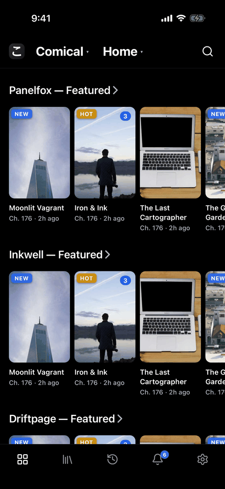
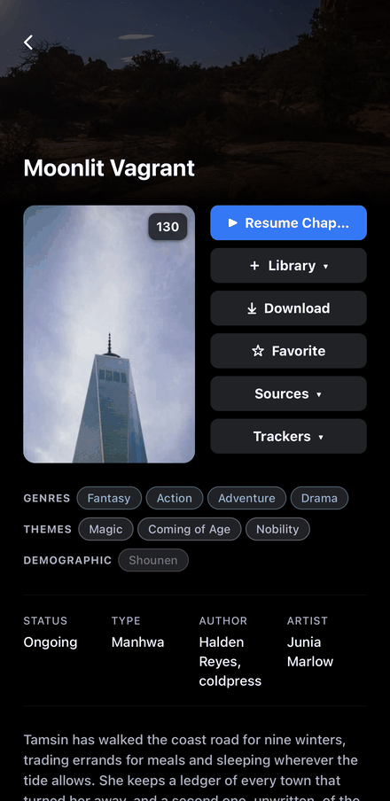
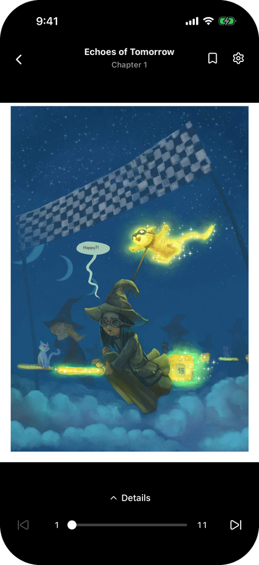
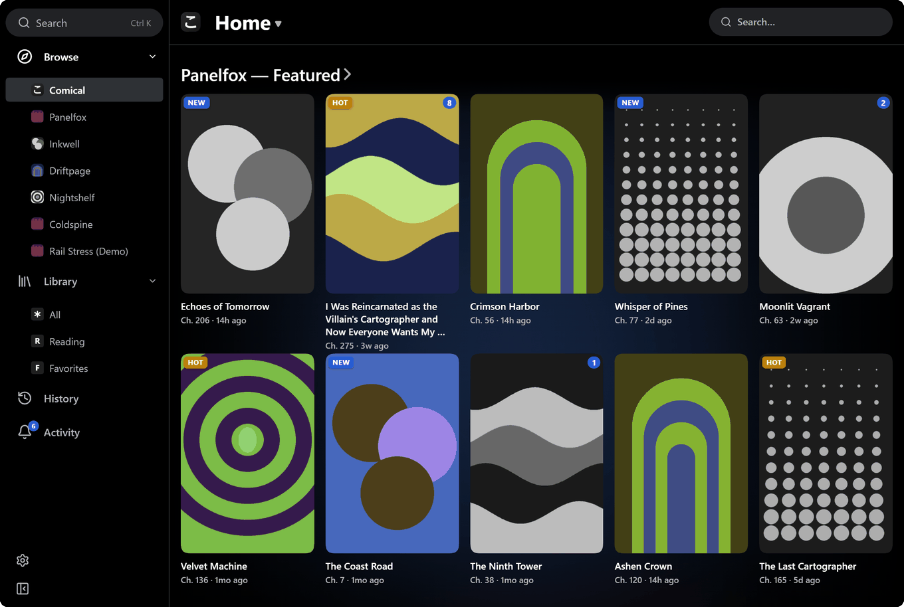

<p align="center">
  
</p>

<h1 align="center">comical</h1>

<p align="center">A cross-platform comic reader for iOS, Android, Desktop, and the web.</p>

<p align="center">
  Comical ships with no sources. You add a registry, install the bridges you want,<br />
  and read from those.
</p>

<p align="center">
  
  
  
</p>

<p align="center">
  
</p>

## Features

- **Paged and long-strip** readers
- **Library**, collections and groups
- **Offline downloads**, with auto-download for new chapters
- **New-chapter feed**, with notifications
- **AniList and MyAnimeList** tracking
- **Sync** between your phones and computer

## Install

### iOS

Install through **[SideStore](https://sidestore.io)** or **[AltStore](https://altstore.io)**.

Add the release channel as a source (**Sources → +**) to get updates:

```
https://github.com/porksphere/comical-app/releases/download/ios-release/apps.json
```

Or install **[comical-unsigned.ipa](https://github.com/porksphere/comical-app/releases/latest)** directly.

### Android

Install
**[comical-android.apk](https://github.com/porksphere/comical-app/releases/download/android-release/comical-android.apk)**
directly.

### Windows & Linux

Install
**[comical-desktop-setup.exe](https://github.com/porksphere/comical-app/releases/download/desktop-release/comical-desktop-setup.exe)**
on Windows. On Linux, use the
**[AppImage](https://github.com/porksphere/comical-app/releases/download/desktop-release/comical-desktop-x86_64.AppImage)**
or the
**[.deb](https://github.com/porksphere/comical-app/releases/download/desktop-release/comical-desktop-amd64.deb)**.

Warning: the installers aren't code-signed, so Windows SmartScreen will warn on first run.

### Web

The frontend and backend can be run as two Docker containers. See
**[docs/SELF-HOSTING.md](docs/SELF-HOSTING.md)** for the compose file and configuration.

A mock preview is deployed to
**[porksphere.github.io/comical-app](https://porksphere.github.io/comical-app/)**.

## How it works

**Registry → bridge → series.**

- A **registry** is a list of bridges you add in Settings. Public ones are listed under the
  **[`comical-registry` topic](https://github.com/topics/comical-registry)** on GitHub.
- A **bridge** is an adapter for one source or service, downloaded and verified from a registry.
- **Series** are what a bridge sources, and what you browse and read.

Registries can also carry **trackers**, which sync your reading progress to services like AniList.

On iOS and Android, bridges run on-device and no server is involved. On the web they run in the
backend you host.

Bridges run against [**comical**](https://github.com/porksphere/comical), the TypeScript core,
which is written to embed in any JS environment. For the full picture, see
**[docs/ARCHITECTURE.md](docs/ARCHITECTURE.md)**.

## Sync

Phones sync their library, progress and installed bridges with the **desktop app** over your
local network. Pair one by scanning the code in **Settings → Sync**. Logins stay on the device, and
everything sent is end-to-end encrypted.

A browser doesn't need sync, since it already reads its server's library.

## Development

Building from source, running locally, and the CI/release pipeline are documented in
**[docs/DEVELOPMENT.md](docs/DEVELOPMENT.md)**. TL;DR for a fresh clone:

```bash
bun run setup   # submodule + deps + native harness
bun run dev     # local web dev in a browser → http://localhost:8081
```
